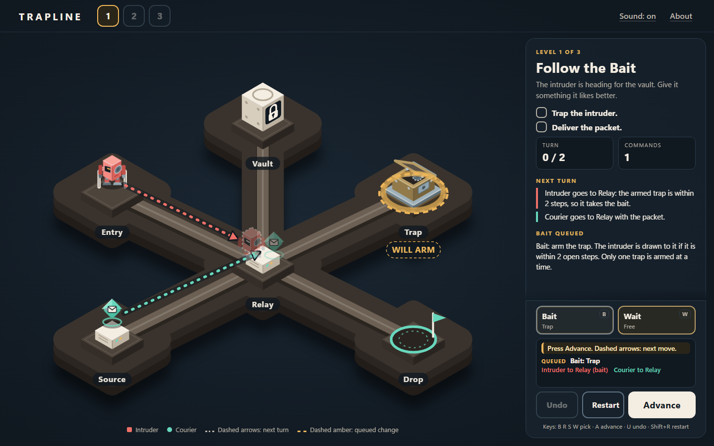
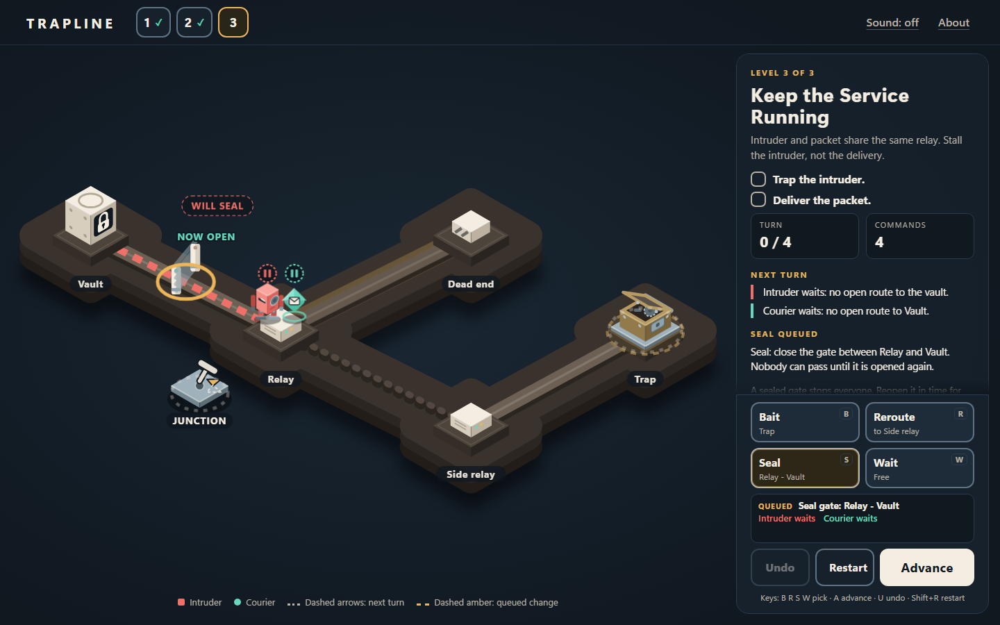
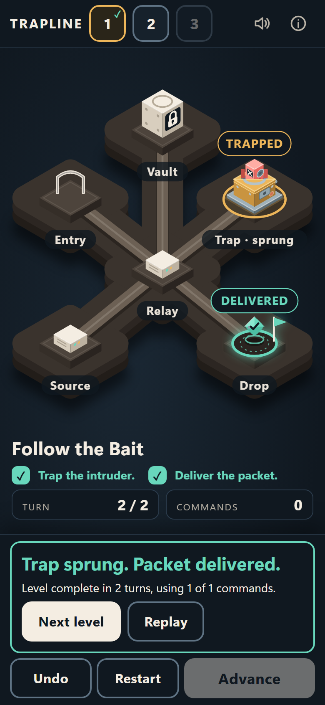

# TRAPLINE

> **Playable prototype (v0.1.0).** A three-level tactical puzzle for the browser.
> **Live demo: https://zuhairhalawa.github.io/Trapline/** (deployed by GitHub Actions and smoke-tested on 2026-10-30 in Chromium desktop and emulated mobile only; details in [docs/RELEASE-0.1.0.md](docs/RELEASE-0.1.0.md)).

Lure a digital intruder into a honeypot (a trap) while a legitimate data packet still reaches its destination. Plan one command per turn, preview what both pieces will do, press Advance, watch it play out. No security knowledge is needed; it is fictional entertainment on a miniature board.

**Objective:** Trap the intruder. Deliver the packet.

## Screenshots

These are real captures of the game from the automated browser tests (Chromium, desktop and emulated phone), kept from earlier QA stages.

| Level 1 preview (desktop) | Level 3 preview (desktop) | Level 1 victory (emulated phone) |
| --- | --- | --- |
|  |  |  |

The title screen also shows AI-generated concept art (not gameplay, not hand-drawn). Its provenance and terms are in [ASSETS.md](ASSETS.md); `docs/qa/a2-1/title-desktop.png` shows it.

## How to play

1. Pick at most one command (or none = **Wait**). Picking and cancelling is free and only changes the preview.
2. Dashed arrows and ghost pieces show where the intruder (coral blocky scout robot) and the courier (mint rounded diamond) go next. A short summary above Advance shows what is queued and what happens next, including a predicted breach.
3. Press **Advance** to spend the turn. **Undo** restores the previous state. **Restart** resets the level.

Commands: **Bait** (arm the honeypot), **Reroute** (flip the marked junction), **Seal/Open** (toggle a gate), **Wait** (free). Full rules: [docs/RULES.md](docs/RULES.md).

Controls: mouse or touch on the buttons or on board targets (trap, junction dial, gate). Keyboard: `B` `R` `S` `W` choose a command, `A` advance, `U` undo, `Shift+R` restart; board targets are focusable and respond to Enter/Space. Level 1 doubles as the introduction.

## Install and run

Node: the locked dependencies need Node `^22.12` or `^24` (some packages require `^22.12.0 || ^24.0.0 || >=26`). Developed on Node 24; CI uses Node 24. Plus npm.

```bash
npm ci             # installs exactly what package-lock.json specifies
npm run dev        # http://127.0.0.1:5173/Trapline/
npm run build && npm run preview   # http://127.0.0.1:4173/Trapline/
```

| Script | What it does |
| --- | --- |
| `npm run typecheck` | `tsc --noEmit` (strict) |
| `npm test` | Vitest unit tests (engine, persistence, reducer, audio guards, text) |
| `npm run build` | Typecheck, then production build to `dist/` |
| `npm run test:e2e` | Playwright: builds, serves with `vite preview` on 4173, runs the Chromium desktop (1440x900) and emulated-mobile (390x844) projects plus a first-view matrix. First time: `npx playwright install chromium`. Screenshots go to `TRAPLINE_QA_DIR` (default git-ignored `test-results/screenshots`); do not point it at `docs/qa/*`. |

The base path `/Trapline/` is set in `vite.config.ts`. CI ([.github/workflows/ci.yml](.github/workflows/ci.yml)) runs locked install, typecheck, unit tests, build, `npm audit` and the full e2e suite on pushes to `main` and pull requests; only successful `main` runs deploy `dist/` to GitHub Pages. Some e2e cases skip by design (viewport-specific cases duplicated across the desktop/mobile projects, a keyboard test on the mobile project and a touch test on the desktop project); each has an explicit reason in the test source.

## Privacy and storage

No accounts, analytics, ads, remote fonts or network calls at runtime. Completed levels and the sound setting are kept in your browser's `localStorage` (key `trapline.progress.v1`) and never leave your device. Clear site data to reset. Corrupt or unavailable storage falls back to defaults and does not block play.

## Tests

Test status for this release (what was run, and when) is recorded in [docs/RELEASE-0.1.0.md](docs/RELEASE-0.1.0.md). The `docs/QA-*.md` files are historical reports of earlier stages and are kept unchanged; their numbers are not re-claimed here.

## Limitations

- Three authored levels only: this is a prototype, not a full campaign. Not playtested by humans; difficulty and fun are unverified.
- Mobile checks used Chromium device emulation, not real phones. No Safari or Firefox runs.
- Audio (synthesised Web Audio) was only verified not to throw; nobody has listened to it on real hardware.
- Accessibility was designed for (labels, live region, keyboard) but is incomplete and not tested with a screen reader.
- Minor known polish issues: at 844x390 a panel heading is partly under the control dock until scrolled; one route line crosses the JUNCTION label in Level 2 at that size (see [docs/QA-A2-1.md](docs/QA-A2-1.md)).
- No security certification of any kind. `npm audit` is a point-in-time dependency check.

Deliberately not included: extra enemies, procedural generation, multiplayer, leaderboards, accounts, level editor, translations, offline mode, story.

## License

Code, CSS and hand-written SVG art: [MIT](LICENSE), (c) 2026 Zuhair Halawa. The AI-generated JPEG images and screenshots that contain them are **not** under that license; see [ASSETS.md](ASSETS.md).

## Docs

[RULES](docs/RULES.md) · [ASSETS](ASSETS.md) · [Release notes/evidence](docs/RELEASE-0.1.0.md) · [ASSET_PROVENANCE](docs/ASSET_PROVENANCE.md) · [ART_DIRECTION](docs/ART_DIRECTION.md) · [QA-A1](docs/QA-A1.md) · [QA-A2](docs/QA-A2.md) · [QA-A2-1](docs/QA-A2-1.md) · [HANDOVER](HANDOVER.md) · [CLAUDE.md](CLAUDE.md)
